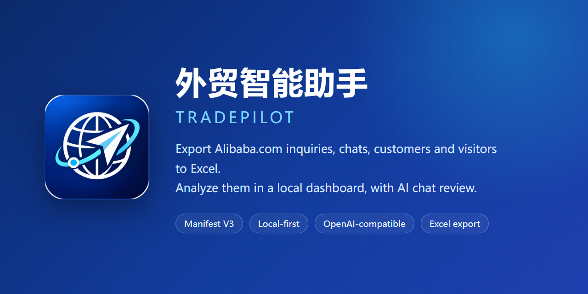

[](https://github.com/CDragon123-code)
[](https://developer.chrome.com/docs/extensions/develop/migrate)
[](https://developer.chrome.com/docs/extensions)
[](https://microsoftedge.microsoft.com/addons)
[](PRIVACY.md)
[](#api-providers)
[](#features)
[](LICENSE)

**English** | [简体中文](README.zh-CN.md)

外贸智能助手 (TradePilot) is a Chrome/Edge extension for Alibaba.com sellers: export inquiries, chats, customers and visitors to Excel, then review the same data in a local dashboard with AI chat analysis. The repository also includes an optional self-hosted cloud data platform under `server/`.

[Privacy](PRIVACY.md) | [Install locally](#install-locally) | [Package for store submission](#package-for-store-submission) | [API providers](#api-providers)

[](docs/images/social-preview.png)

## Why TradePilot

A B2B pipeline on Alibaba.com is scattered across four pages: inquiry list, chat window, CRM customer list, and visitor analytics. Each has its own filters, its own date picker, and no clean way out.

TradePilot is built around one weekly loop:

1. Pick a date range and export the inquiry list.
2. Enrich every row with buyer profile data (company, level, contact, activity).
3. Filter by country and dedupe by buyer before writing back.
4. Export the matching chat history and let a model grade intent and next steps.
5. Review everything in one dashboard: leads to follow, customers at risk, demand words.
6. Repeat next week with a fresh export.

Everything runs on the seller page you are already logged into. Cloud sync is optional and disabled by default; when enabled, data is uploaded only to a server you deploy yourself.

## Features

* **Inquiry export** — inquiry list to Excel, with customer enrichment (company, level, contact, registration date, trade volume, buyer profile).
* **Inquiry enhancement** — collect first, then filter by country, dedupe by buyer, and show each buyer's local time before exporting.
* **Chat export** — one-to-one chat history for any date range (time, role, sender, content, conversation).
* **Chat analysis (AI)** — streaming intent grading and follow-up checklist from real chat records, with multi-turn questions.
* **Customer export** — "My customers" and "Public pool", filterable by created / claimed / pool-entry date.
* **Visitor export** — store visitor rows including search terms, source words, dwell time and RFQ count (keep one range under ~30 days).
* **Ads diagnosis** — one-click collection of account/plan/product/geo/search-term reports, with 90-day diagnosis, 14-day forecast, margin and value matrix.
* **Data dashboard** — built-in page with today's to-dos, inquiry leads, customer assets, demand words, ads diagnosis, weekly report, and a library of imported files.
* **Local library** — every export is ingested automatically; existing `.xlsx` files can be imported too.
* **Optional cloud sync** — ingested rows go into a local outbox and upload to your own server in batches, with retry and resume.
* **Optional self-hosted cloud platform** — data assets, master data, quality checks, AI agent tasks, API gateway and audit, and a business overview. Deploy with Docker Compose from `server/`.
* **OpenAI-compatible models** — DeepSeek, Qwen, OpenAI, Zhipu GLM or any custom `/chat/completions` endpoint.

## Dashboard

| Section             | Purpose                                                                                   |
| ------------------- | ----------------------------------------------------------------------------------------- |
| Today's To-dos      | Highest-priority follow-ups from the last 7 days: unanswered, untransformed, at risk.      |
| Inquiry Leads       | Channel performance, country mix, buyer level, and untransformed leads ranked first.       |
| Customer Assets     | High-value customers, churn warnings, and public-pool picks by level.                      |
| Demand Words        | Real buyer search terms from visitors plus high-frequency words from inquiries and chats.  |
| Ads Diagnosis       | 90-day ads diagnosis, 14-day forecast, attribution and value matrix.                       |
| Weekly Report       | Full breakdown tables for inquiry, customer, and chat dimensions.                          |
| Library             | Import, inspect, and delete ingested files; export/import the whole local database.        |
| Settings            | Model presets, Base URL, API Key, and model name.                                          |

## Permissions

| Permission           | Why                                                                                     |
| -------------------- | --------------------------------------------------------------------------------------- |
| `downloads`          | Save the generated Excel file with a stable, readable filename.                          |
| `scripting`          | Create the blob download inside the page so the platform's own download path is used.    |
| `storage`            | Keep settings, API key, and pending job state in the local browser.                      |
| `unlimitedStorage`   | Hold the local IndexedDB dataset used by the dashboard.                                  |
| `cookies`            | Optional cloud collector: upload the Alibaba login state to the server you configure.    |
| `https://*.alibaba.com/*` | Read the pages and endpoints you are already logged into.                          |
| AI provider domains  | Send prompts to the model endpoint you configure. No other host is contacted.            |

The extension works standalone by default. Cloud sync is optional and disabled by default; when enabled, data is uploaded only to the server you configure.

## API Providers

The dashboard and chat analysis support OpenAI-compatible `/chat/completions` APIs. Built-in presets:

* DeepSeek
* Qwen (DashScope compatible mode)
* OpenAI
* Zhipu GLM
* Custom OpenAI-compatible endpoint

API keys are stored only in `chrome.storage.local` on your machine.

## Cloud Platform (Optional)

The repository includes a self-hosted data platform under `server/`:

- Node.js 22 + PostgreSQL + Caddy, deployed with Docker Compose.
- Data assets, master data, quality checks, AI agent tasks, API gateway and audit, and a business overview.
- Multi-tenant and multi-seller data separation; sub-account data can be isolated by `seller_id`.
- No production endpoints, credentials, cookies or customer data are included. Configure your own `.env` before deployment.

See [server/README.md](server/README.md) for deployment and API details.

## Install Locally

1. Open `chrome://extensions` (or `edge://extensions`).
2. Enable **Developer mode**.
3. Choose **Load unpacked**.
4. Select this project folder.
5. Open an Alibaba.com seller page (e.g. `message.alibaba.com`) and click the **智能助手** dock on the left.

## Package for Store Submission

Create a ZIP with the extension files at the root:

```powershell
Compress-Archive -Path manifest.json,dashboard.html,src,assets,README.md,PRIVACY.md -DestinationPath tradepilot-v1.0.0.zip -Force
```

Do not include `.git`, `docs`, `qrcode.jpg`, or existing `.zip` files in the store package.

## Repository Structure

```
manifest.json
dashboard.html
executor.html
options.html
src/
  content.js        in-page workbench UI + collection and export
  background.js     download rename, request proxy, ingest, AI streaming
  cloud-outbox.js   optional cloud upload queue
  db.js             IndexedDB data layer
  analyze.js        dashboard metrics
  dashboard.js      dashboard views
  inquiry-reply.js  send-gate checks
  dify.js           Dify knowledge-base client
assets/
  icon-16/32/48/128/256/512.png
docs/images/
server/
  src/              Node.js API
  migrations/       PostgreSQL schema
  public/           cloud console pages
  collector/        optional server-side inquiry collector
  deploy/           Docker Compose, Caddy, backup scripts
  test/             Node test suite
README.md
README.zh-CN.md
PRIVACY.md
LICENSE
qrcode.jpg
```

## Privacy

The extension works standalone by default. Exported Excel files go straight to your downloads folder; dashboard data lives in the extension's IndexedDB; settings and API keys live in `chrome.storage.local`.

The optional `server/` platform is self-hosted. When cloud sync is enabled, selected data and the Alibaba login state are uploaded only to the server you configure. Nothing is proxied through the author.

When you use AI analysis, the prompt is sent from your browser directly to the API endpoint you configured.

See [PRIVACY.md](PRIVACY.md) for details.

## License

Released under [PolyForm Noncommercial 1.0.0](LICENSE) — free to use, modify and share for personal and non-commercial purposes.

**Commercial use requires written authorization from the author.** Open an issue in this repository to discuss a commercial license.

## Status

MVP for personal use and validation. Platform endpoints change without notice, so a broken feature usually means a changed field rather than a broken extension. Not affiliated with Alibaba Group. Use it only for accounts you own and follow the platform terms.

This public repository contains no real customer data, production credentials, cookies, or deployed endpoints. Test fixtures use fictional names and data.

---

## About the Author

[](qrcode.jpg)

**🐉 AICDragon** — AI Tools & Real-World Practice

Open-source AI agent automation · local LLM · hands-on guides

Weekly deep-dives on AI in action. Find me as **AICDragon** across all platforms.
