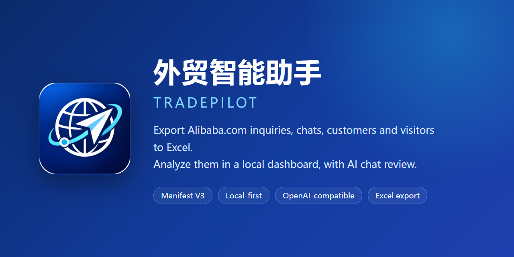

[](https://github.com/CDragon123-code)
[](https://developer.chrome.com/docs/extensions/develop/migrate)
[](https://developer.chrome.com/docs/extensions)
[](https://microsoftedge.microsoft.com/addons)
[](PRIVACY.md)
[](#模型服务)
[](#功能)
[](LICENSE)

[English](README.md) | **简体中文**

外贸智能助手（TradePilot）是一个面向阿里国际站卖家的 Chrome/Edge 扩展：把询盘、聊天、客户、访客数据导出为 Excel，同时在本地数据看板里做统计与 AI 聊天分析。

[隐私说明](PRIVACY.md) | [本地安装](#本地安装) | [打包上架](#打包上架) | [模型服务](#模型服务)

[](docs/images/social-preview.png)

## 为什么做 TradePilot

国际站的日常跟进分散在四个页面：询盘列表、聊天窗口、CRM 客户列表、访客分析。每个页面都有自己的筛选和日期控件，但都没有干净的出口。

TradePilot 围绕一个每周可复用的闭环：

1. 选好时间范围，导出询盘列表。
2. 自动补全每行的客户画像（公司、等级、联系方式、活跃度）。
3. 按国家筛选、按买家去重，再决定回复谁。
4. 导出对应时间段的聊天记录，让模型给出意向分级与跟进动作。
5. 在同一个看板里复盘：该跟进的线索、有流失风险的客户、买家搜索词。
6. 下周再导一次，对比变化。

全部动作都在你已登录的卖家页面内完成。没有后端、没有第三方采集服务、不需要共享账号。

## 功能

* **询盘导出** —— 询盘列表导出为 Excel，并补全公司、等级、联系方式、注册时间、订单金额与买家画像。
* **询盘增强** —— 先采集再本地筛选：按国家过滤、按客户去重、显示客户当地时间，确认后再导出。
* **聊天导出** —— 任意时间段的一对一聊天记录（发送时间 / 角色 / 发言人 / 内容 / 会话）。
* **聊天分析（AI）** —— 基于真实聊天记录流式输出意向分级与跟进清单，支持多轮追问。
* **客户导出** —— 「我的客户」与「公海客户」，可按创建时间 / 领取时间 / 进入公海时间筛选。
* **访客导出** —— 访客搜索词、进店来源词、停留时长、RFQ 数等；单次范围建议不超过 30 天。
* **数据看板** —— 扩展内置页：今日待办、询盘线索、客户资产、需求词库、复盘报表、资料库。
* **本地资料库** —— 导出成功自动入库，也支持导入已有的 `.xlsx` 文件。
* **兼容 OpenAI 协议** —— DeepSeek、通义千问、OpenAI、智谱 GLM，或任意自定义 `/chat/completions` 地址。

## 数据看板

| 分区     | 作用                                                               |
| -------- | ------------------------------------------------------------------ |
| 今日待办 | 近 7 天最该做的事：未回复、未转化、有流失风险的客户按优先级排列。  |
| 询盘线索 | 渠道效果、国家分布、买家等级，以及排在前面的未转化线索。           |
| 客户资产 | 高价值客户、流失预警、公海可捡名单。                               |
| 需求词库 | 访客真实搜索词 + 询盘与聊天里的高频词，可直接指导上架与标题。      |
| 复盘报表 | 询盘 / 客户 / 聊天三个维度的完整明细表。                           |
| 资料库   | 导入、查看、删除已入库文件；整库导出与导入备份。                   |
| 设置     | 模型预设、Base URL、API Key、模型名。                              |

## 权限说明

| 权限                  | 用途                                                               |
| --------------------- | ------------------------------------------------------------------ |
| `downloads`           | 用稳定可读的中文文件名保存 Excel。                                 |
| `scripting`           | 在页面内触发下载，走平台自身的下载链路，文件名不被吞掉。           |
| `storage`             | 保存设置、API Key 与待执行任务状态。                               |
| `unlimitedStorage`    | 存放看板使用的本地 IndexedDB 数据。                                |
| `https://*.alibaba.com/*` | 读取你已登录的页面与页面自身接口。                             |
| 模型服务域名          | 只把提示词发送到你配置的模型地址，不访问其他主机。                 |

不申请 `cookies` 权限，没有后台网络服务，也没有任何远程日志。

## 模型服务

看板与聊天分析通过 OpenAI 兼容的 `/chat/completions` 调用模型，内置预设：

* DeepSeek
* 通义千问（DashScope 兼容模式）
* OpenAI
* 智谱 GLM
* 自定义 OpenAI 兼容地址

API Key 只保存在本机 `chrome.storage.local`。

## 本地安装

1. 打开 `chrome://extensions`（Edge 为 `edge://extensions`）。
2. 开启右上角「开发者模式」。
3. 点「加载已解压的扩展程序」。
4. 选择本项目根目录。
5. 打开阿里国际站卖家后台（如 `message.alibaba.com`），点左侧「智能助手」入口。

## 打包上架

生成 ZIP 时把扩展文件放在压缩包根目录：

```powershell
Compress-Archive -Path manifest.json,dashboard.html,src,assets,README.md,PRIVACY.md -DestinationPath tradepilot-v1.0.0.zip -Force
```

不要把 `.git`、`docs`、`qrcode.jpg` 或旧的 `.zip` 打进上架包。

## 目录结构

```
manifest.json
dashboard.html
src/
  content.js      页面内工作台 UI + 采集与导出
  background.js   下载改名、请求代理、入库、AI 流式转发
  db.js           IndexedDB 数据层
  analyze.js      看板统计口径
  dashboard.js    看板视图
  sse.js          SSE 流式解析
assets/
  icon-16/32/48/128/256/512.png
docs/images/
README.md
README.zh-CN.md
PRIVACY.md
qrcode.jpg
```

## 隐私

TradePilot 没有后端。导出的 Excel 直接落到本机下载目录；看板数据存在扩展的 IndexedDB；设置与 API Key 存在 `chrome.storage.local`。

使用 AI 分析时，提示词由浏览器直接发送到你配置的模型接口，不经过作者的任何服务器。

详见 [PRIVACY.md](PRIVACY.md)。

## 许可

本项目采用 [PolyForm Noncommercial 1.0.0](LICENSE)：个人使用与非商业用途可自由使用、修改与分发。

**商业用途需取得作者书面授权。** 可在本仓库提交 issue 说明用途，协商商业授权。

## 状态

MVP，用于自用与验证。平台接口会不定期调整，某个功能失效通常是字段变化而非扩展损坏。本项目与阿里巴巴集团无关；请仅用于你本人拥有权限的账号，并遵守平台条款。

---

## 关于作者

[](qrcode.jpg)

**🐉 AICDragon** — AI 工具与真实落地实践

开源 AI Agent 自动化 · 本地大模型 · 实操指南

每周更新 AI 实战拆解，全平台同名 **AICDragon**。
